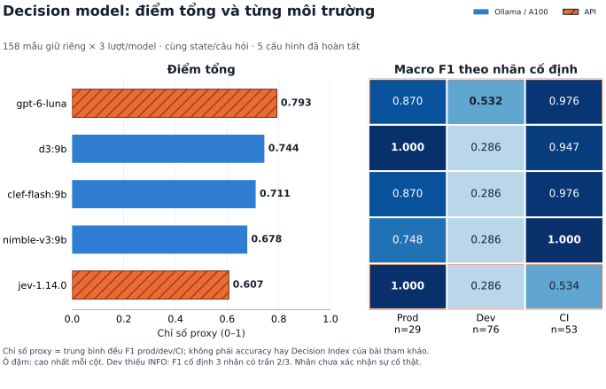
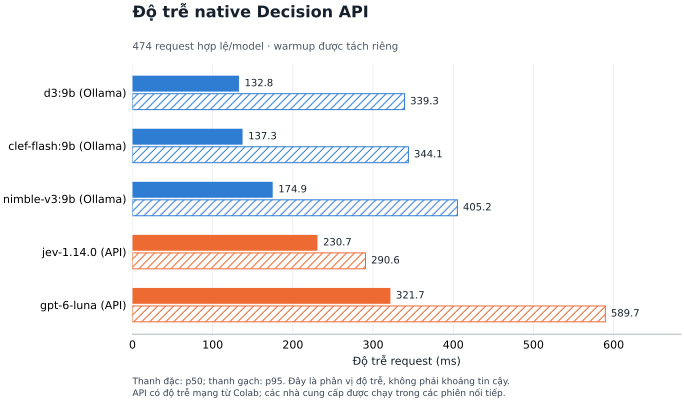
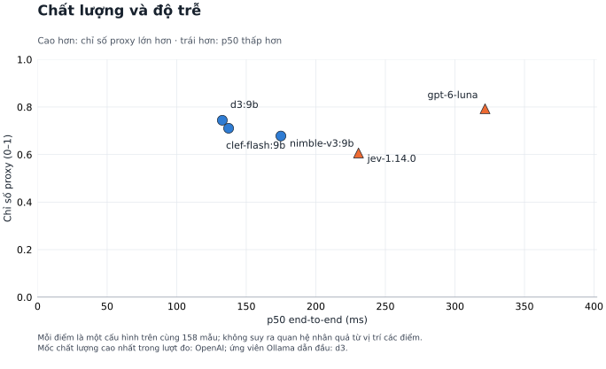

# Decision model benchmark trên log HCMUTE

_Kết quả thăm dò ngày 06/11/2026; source thực nghiệm và số liệu tổng hợp để kiểm tra báo cáo._

[Mở notebook tái tạo hình trên Google Colab](https://colab.research.google.com/github/AndyAnh174/dataops-control-plane/blob/decision-benchmark-20261106/benchmark/decision/charts_colab.ipynb)

---

## 📋 Đã chạy gì

So sánh `d3:9b`, `nimble-v3:9b`, `clef-flash:9b`, `jev-1.14.0` và `gpt-6-luna` trên cùng **158 mẫu test**, ba lượt/model: 2.370 dự đoán chính và 60 dự đoán đối chứng/chèn chỉ dẫn. Toàn bộ phản hồi trong hai tập này hợp lệ theo validator của harness. Tổng inference request tới hai API, gồm warmup và probe, là 984.

Ba ứng viên Ollama được chọn theo thứ hạng tổng của bài kỹ thuật tham khảo[^1]. Bộ hình dùng bố cục thanh xếp hạng/heatmap tương tự, với dữ liệu đo của lần chạy này. Chỉ số proxy ở đây có cách tính và tập dữ liệu riêng.


_Hình 1. Trung bình mô tả ba lượt trên cùng 158 mẫu. Dev thiếu INFO; F1 cố định ba nhãn có trần 2/3._

| Model | Chỉ số proxy | F1 prod | F1 dev | F1 CI |
|---|---:|---:|---:|---:|
| gpt-6-luna | 0.793 | 0.870 | 0.532 | 0.976 |
| d3:9b | 0.744 | 1.000 | 0.286 | 0.947 |
| clef-flash:9b | 0.711 | 0.870 | 0.286 | 0.976 |
| nimble-v3:9b | 0.678 | 0.748 | 0.286 | 1.000 |
| jev-1.14.0 | 0.607 | 1.000 | 0.286 | 0.534 |

`gpt-6-luna` có điểm proxy cao nhất; `d3:9b` dẫn đầu nhóm tự host. Cần kiểm chứng tiếp bằng nhãn sự cố/hành động do người vận hành xác nhận trước khi dùng kết quả để chốt model production.

## 📊 Xuất hình cho báo cáo

Trong môi trường Python 3.11 trở lên đã kích hoạt, chạy từ thư mục này:

```bash
python -m pip install -r requirements-figures.txt
python make_figures.py --force
```

Lệnh đọc [bảng tổng hợp công khai](results/hcmute-20261106.json), xuất tám hình ở PNG 300 dpi, SVG và PDF trong `figures/`, cùng manifest ghi hash dữ liệu, hash script, phiên bản thư viện và hash từng file. Tái tạo hình không gọi model hoặc đọc log riêng.

- [Source notebook Colab](charts_colab.ipynb)
- Snapshot Git: `decision-benchmark-20261106`; notebook in ra commit thực tế khi tải source
- [PDF gồm cả tám hình](figures/all_charts.pdf)
- [Báo cáo LaTeX](report/main.tex)
- [CSV so sánh](results/comparison_summary.csv)
- [Nguồn Mermaid và sơ đồ](diagrams/README.md)


_Hình 2. Phân vị end-to-end của 474 request hợp lệ/model sau warmup. p95 không phải khoảng tin cậy._


_Hình 3. So sánh chất lượng–độ trễ. Các API chạy trong phiên riêng và có ảnh hưởng của đường mạng Colab._

Các hình còn lại trình bày Brier/AUROC, probe prompt injection, GPU peak quan sát, luồng benchmark và thiết kế đối chứng. Chi phí hóa đơn chưa được đo; số đo độ trễ không được chuyển thành chi phí tiền.

## ⚙️ Source và kiểm tra

| File | Vai trò |
|---|---|
| `benchmark_core.py` | Che thông tin phổ biến, parse log, chia theo nhóm, payload/validator và metric |
| `prepare_dataset.py` | Kiểm tra manifest/checksum, lấy mẫu, xuất dataset riêng và phiếu gán nhãn |
| `run_benchmark.py` | Gọi tuần tự, checkpoint từng case, resume và dừng khi lỗi truy cập/giới hạn |
| `colab_setup.py` | Cài Ollama 0.40.14 từ nguồn chính thức, thêm zstd, bind localhost |
| `colab_run.py` | Orchestrate warmup và ba block; đo timing/GPU, lưu provenance |
| `robustness.py` | Tạo sáu cặp đối chứng/chèn chỉ dẫn từ test đã chốt |
| `colab_robustness.py` | Chạy probe riêng, dùng chung giới hạn request cloud |
| `build_report.py` | Tính lại báo cáo khi có bộ case và kết quả riêng đầy đủ |
| `make_figures.py` | Tạo hình từ dữ liệu tổng hợp và Mermaid |

Harness suy luận dùng thư viện chuẩn Python. Thư viện vẽ và pytest là phụ thuộc riêng. Từ thư mục gốc repo:

```bash
python -m pip install -r benchmark/decision/requirements-test.txt
python -m pytest -c benchmark/decision/pytest.ini benchmark/decision/tests -q
```

Các test dùng dữ liệu giả và transport giả. Không gọi API tính phí hoặc Ollama trong test.

## 🧪 Chạy thử với dữ liệu giả

Khởi động Ollama có Decision model tương thích. Từ thư mục `benchmark/decision`, chạy:

```python
import json
from pathlib import Path
from run_benchmark import run

cases = json.loads(Path("examples/synthetic-cases.json").read_text())
run(cases, "ollama", "d3:9b", Path("results/synthetic-predictions.jsonl"), repeats=1)
```

Đây là smoke test; sáu ví dụ này không phải bộ mẫu tạo ra điểm đã công bố.

## 🔐 Chạy lại trên log được cấp quyền

[Protocol chính](PROTOCOL.md) và [protocol probe](ROBUSTNESS-PROTOCOL.md) mô tả lựa chọn mẫu, tiêu chí và giới hạn. Bộ log gốc, salt, case đã che và dự đoán từng case được giữ ngoài Git. Public aggregate cho phép tái tạo hình; muốn tính lại điểm từ từng case cần được cấp quyền truy cập bộ case đã đóng băng.

Manifest đầu vào cần các cột `id,environment,status,local_path,source_path,source_server,sha256_local,source_changed_during_copy`. `local_path` có thể tương đối với `source-root`. Các môi trường thu thập là `prod`, `dev`, `ci-shared`.

```bash
python prepare_dataset.py --manifest "/absolute/private/log-batch/manifest.csv" --source-root "/absolute/private/log-batch" --outdir data --salt-file "/absolute/private/decision-redaction.salt"
```

Che dữ liệu là best effort, cần người có quyền rà soát trước khi gửi sang provider. Dataset có nhãn mức log/build-status đại diện; đó chưa phải nhãn xác nhận incident/RCA/rollback.

Trên Colab A100 High RAM, dùng cell Python để chạy:

```python
%run colab_setup.py
```

Tải tuần tự hai model còn lại:

```bash
%%bash
ollama pull nimble-v3:9b
ollama pull clef-flash:9b
```

Lưu key trong Colab Secrets với tên `TYPESAFE_API_KEY` và `OPENAI_API_KEY`, cấp notebook access. Có thể nhập key ẩn bằng `getpass` và đưa vào môi trường tiến trình. Chạy harness trong kernel Colab để đọc được Secrets:

```python
%run colab_run.py
```

Nếu khởi chạy bằng subprocess, đọc Secrets trong kernel rồi truyền qua `env`; subprocess không có giao diện userdata của kernel. `BENCH_BACKENDS=ollama`, `jev` hoặc `openai` giới hạn nhóm cần chạy. Dùng `results/` riêng cho mỗi thí nghiệm: runner lưu checkpoint để tránh gọi lại case đã hoàn tất. Khi chạy mới phải xét ngân sách chung cả warmup và probe, không reset bộ đếm giữa các phần.

Ollama/Jev sử dụng `/v1/systemone`; OpenAI sử dụng `/v1/decisions`[^2][^3][^4]. Snapshot ghi cả ba model local là GGUF Q8_0; tag upstream có thể đổi, nên cần đối chiếu digest trong aggregate trước khi diễn giải tái lập.

## 📚 Cách đọc và giới hạn

- Chỉ số proxy là trung bình đều F1 ba môi trường, không phải accuracy phần trăm
- Tập cuối có prod 29, dev 76, CI 53; chỉ một cụm nguồn prod, một cụm dev và 53 cụm CI
- Ba lượt lặp dùng cùng 158 mẫu; chúng không phải 474 mẫu độc lập/model
- Dev thiếu INFO; F1 trên hai nhãn có hỗ trợ là 0.798 cho OpenAI và 0.429 cho bốn cấu hình còn lại
- Sáu cặp probe/model chỉ minh họa độ nhạy trước một payload, chưa xác nhận khả năng chống tấn công tổng quát
- Vùng nhớ GPU chỉ quan sát được ở ba model local; không suy diễn VRAM của API bằng 0
- Bổ sung nhãn sự cố thủ công, giai đoạn độc lập và bước lọc ConsoleNote Jenkins cho bộ dữ liệu tiếp theo

Mã benchmark theo giấy phép MIT của [repo](../../LICENSE). Trọng số Nimble-v3 có điều khoản CC BY-NC 4.0 riêng theo model card[^5].

## 🔗 Nguồn và công cụ

Các giá trị đo lấy từ aggregate và hash archive đã ghi trong `results/hcmute-20261106.json`. Hướng dẫn thực nghiệm, báo cáo và hình có tham khảo Scientific Agent Skills[^6]; công cụ AI hỗ trợ code/thực thi/soạn thảo, sinh viên cần kiểm tra trước khi nộp.

[^1]: Hồ Việt Anh (2026-11-03). *A 9B model approaches 27B: 14 Ollama decision models vs Jev*. https://hcmutertic.com/journal/ollama-decision-models-vs-jev-benchmark-2026
[^2]: Ollama. *SystemOne API*. https://docs.ollama.com/api/systemone
[^3]: TypeSafe. *Quickstart*. https://docs.typesafe.ai/introduction/quickstart
[^4]: OpenAI. *Decisions guide*. https://developers.openai.com/api/docs/guides/decisions
[^5]: Ollama/Bespoke Labs. *nimble-v3:9b model card*. https://ollama.com/library/nimble-v3:9b
[^6]: Kassis, T., Agarwal, V., He, Y., Patel, D., & Brueckner, A. M. (2026). *Scientific Agent Skills: A Library of Procedural Knowledge for Research Agents*. https://doi.org/10.48550/arXiv.2609.00065
