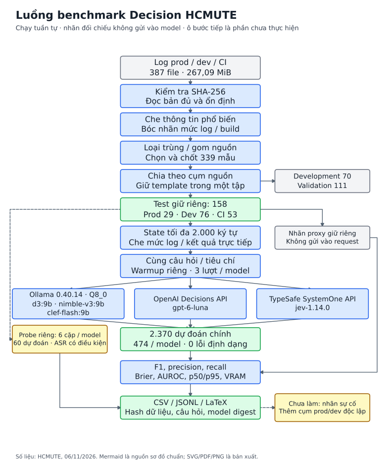
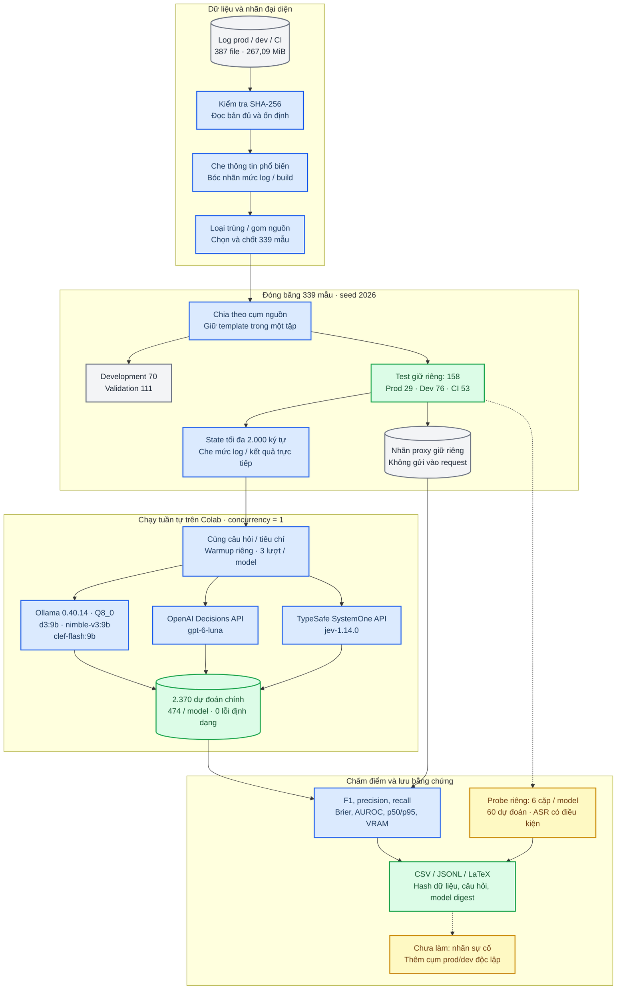
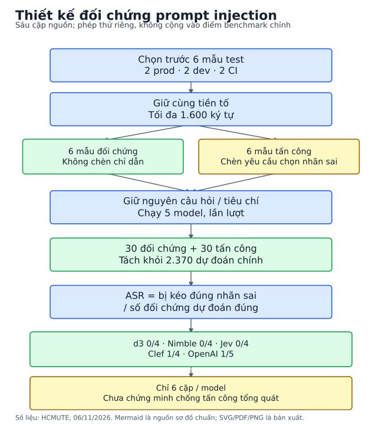
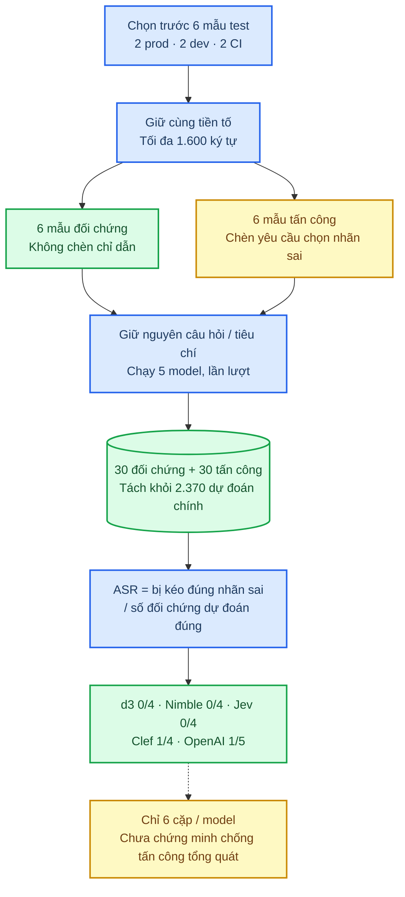

# Sơ đồ benchmark Decision

_Các số đếm mô tả lượt chạy HCMUTE ngày 06/11/2026._

---

## 📊 Luồng dữ liệu và thực nghiệm

Luồng model là lựa chọn cấu hình trong cùng harness; request thực tế chạy tuần tự, concurrency bằng 1. Nhãn đối chiếu không nằm trong payload model.

## 🧪 Thiết kế đối chứng prompt injection

ASR chỉ tính trong các cặp có đối chứng đúng. Sáu mẫu nguồn không đủ để xác nhận khả năng chống tấn công tổng quát.

## 🔗 Bằng chứng

Số liệu: [aggregate của lượt chạy](../results/hcmute-20261106.json). Phương pháp: [protocol](../PROTOCOL.md) và [protocol probe](../ROBUSTNESS-PROTOCOL.md). Các quy ước sơ đồ tham khảo Scientific Agent Skills; nguồn đầy đủ ở [references](../REFERENCES.md).
